# 🌌 Awesome 3D Solar Rendering & Astronomy Viz 🪐

  <strong>Curated ecosystem of SaaS astronomy platforms, interactive 3D planetariums, real-time celestial ephemeris simulators, and open-source astrophysics visualization engines.</strong>

  
  
  
  
  
  
  

---

## 🧭 Table of Contents

- [🌌 Sector Overview & Market Dynamics](#-sector-overview--market-dynamics)
- [☁️ SaaS & Hosted Astronomy Platforms](#️-saas--hosted-astronomy-platforms)
- [💻 Open-Source GitHub Projects](#-open-source-github-projects)
- [🛠️ Key Frameworks & Building Blocks](#️-key-frameworks--building-blocks)
- [🤝 How to Contribute](#-how-to-contribute)
- [☕ Support](#-support)
- [📈 Star History](#-star-history)
- [⚠️ Disclaimer](#️-disclaimer)

---

## 🌌 Sector Overview & Market Dynamics

The global **3D simulation, astronomy, and planetarium software sector** represents an estimated **$7.5B to $8.2B market** (expanding toward **$40B by the mid-2030s** at an estimated CAGR of ~16.5%), propelled by WebGL/WebGPU acceleration, STEM digital-twin adoption, aerospace mission telemetry, and photorealistic spatial rendering. The sector is **moderately fragmented**: specialized consumer stargazing and astrophotography SaaS niches sustain independent and bootstrapped developers, while large institutional entities (e.g., NASA/JPL, ESA, CDS Strasbourg, and Alphabet) provide foundation-level ephemeris data, sky survey infrastructure, and institutional-grade visualization platforms.

---

## ☁️ SaaS & Hosted Astronomy Platforms

The following SaaS and hosted astronomy platforms are sorted in descending order by parent company size (valuation / annual budget / market capitalization).

| Platform 🌐 | Description 📝 | Company Scale / Valuation / Revenue 🏢 | Pricing (Starting Tier) 💵 | Free Tier Limits / Trial Period ⏱️ |
|:---|:---|:---|:---|:---|
| **[Google Sky](https://www.google.com/sky/)** | Web-based celestial viewer visualizing Hubble Space Telescope imagery, infrared/microwave sky surveys, and constellations. | **Alphabet Inc. (~$2.1T Market Cap)** | **$0.00** (Ad-supported / Enterprise Cloud API pricing applies if consuming Google Earth Engine / Maps API starting at $200 free monthly credit) | **Free forever without restrictions** across all standard web browsing modes |
| **[NASA Eyes](https://eyes.nasa.gov/)** *(Eyes on the Solar System)* | Interactive cloud-based 3D web visualization platform exploring planets, moons, asteroids, and real-time spacecraft missions. | **NASA / US Federal Agency (~$25.4B Annual Budget)** | **$0.00** (Publicly funded US Federal science service; zero subscription fees) | **Free forever without restrictions**; full access to real-time JPL orbital ephemeris data |
| **[Aladin Sky Atlas](https://aladin.cds.unistra.fr/AladinLite/)** *(Aladin Lite)* | Interactive cloud sky atlas developed by CDS Strasbourg for visualizing multi-wavelength HiPS astronomical imagery and SIMBAD catalogs. | **CDS Strasbourg / CNRS (~$4.5B CNRS Annual Budget)** | **$0.00** (Academic scientific public service funded through French national research endowments) | **Free forever without restrictions**; unlimited queries to CDS/SIMBAD/VizieR astronomical catalogs |
| **[Star Walk 2](https://starwalk.space/)** | Interactive mobile and web stargazing atlas offering real-time sky mapping, 3D planetary models, and AR constellations. | **Vito Technology (~$10M–$25M Estimated Valuation / Multi-million ARR)** | **$0.99** (Starting standalone content pack) / **$5.99** (Star Walk 2 Pro full feature unlock) | **Free forever version** (ad-supported; limited to basic stars, moon, and visible planets; satellites, 3D deep-sky objects, and extended catalogs require purchase) |
| **[SkySafari](https://skysafariastronomy.com/)** | Mobile and cloud-synced planetarium and telescope-control suite featuring deep-sky databases and session planning. | **Simulation Curriculum Corp. (~$5M–$15M Estimated Valuation)** | **$4.99** (One-time starting tier for SkySafari 8 Basic; SkySafari 8 Plus is $19.99, Pro is $34.99) | **Free forever plan unavailable**; no perpetual free tier (limited free promo trials run periodically for 7 days via app store campaigns) |
| **[Stellarium Web](https://stellarium-web.org/)** | Cloud-hosted online planetarium engine rendering realistic night skies, constellations, deep-sky objects, and satellite passes. | **Stellarium Labs (~$2M–$5M Estimated Valuation)** | **$19.99** (One-time purchase for Stellarium Plus Mobile) or **$1.99/mo** (Stellarium Plus Cloud sync subscription) | **Free forever web app** (basic Hipparcos catalogue ~60k stars, major planets, and standard constellations; deep-sky catalogs of 1B+ stars and telescope control require Stellarium Plus) |
| **[Solar System Scope](https://www.solarsystemscope.com/)** | Interactive web and mobile 3D solar system and night-sky model featuring real-time planetary positions and educational tours. | **INOVE s.r.o. (~$1M–$5M Estimated Valuation)** | **$3.99** (One-time starting price for ad-free high-resolution textures and offline encyclopedia desktop/mobile licenses) | **Free forever web/mobile edition** (ad-supported; standard texture resolution; full access to solar system navigation and planetary orbits) |
| **[SpaceEngine](https://spaceengine.org/)** | Photorealistic 3D universe simulator combining real astronomical catalogs with procedural planets, galaxies, and black holes. | **Cosmographic Software (~$1M–$3M Estimated Valuation)** | **$29.99** (Starting purchase tier on Steam) / **$59.99** (SpaceEngine PRO commercial/creator license) | **Free forever legacy version** (SpaceEngine v0.980 is available free indefinitely with older graphics pipeline; Steam release has no free trial) |
| **[AstroBin](https://www.astrobin.com/)** | Cloud image-hosting, plate-solving, and community portfolio platform built specifically for astrophotographers. | **AstroBin / Salvatore Iovene (~$500K–$2M Estimated Valuation)** | **$28.50/year** (Starting Lite plan) / **$57.00/year** (Premium plan) | **Free trial / First Light account** capped strictly at a maximum lifetime storage of **10 images** (max 25MB/image) with public gallery browsing |

---

## 💻 Open-Source GitHub Projects

Curated list of open-source astronomy engines, 3D solar system simulators, ephemeris toolkits, and WebGL celestial frameworks. **Sorted in descending order by GitHub stargazers count.**

| Repository 🛰️ | Stars ⭐ | Primary Focus & Capabilities 🔭 | License 📜 |
|:---|:---|:---|:---|
| **[CesiumGS/cesium](https://github.com/CesiumGS/cesium)** |  | Open-source JavaScript engine for world-class 3D geospatial globes, lunar/Martian terrain rendering, and space trajectory visualization. | Apache-2.0 |
| **[Stellarium/stellarium](https://github.com/Stellarium/stellarium)** |  | Flagship cross-platform 3D desktop planetarium software rendering physically accurate real-time skies with OpenGL. | GPL-2.0 |
| **[astropy/astropy](https://github.com/astropy/astropy)** |  | Core Python astronomy and astrophysics library offering celestial coordinate transformations, FITS I/O, and cosmological calculation algorithms. | BSD-3-Clause |
| **[mourner/suncalc](https://github.com/mourner/suncalc)** |  | Ultra-compact, zero-dependency JavaScript library for calculating precise sun position, sunlight phases, and lunar position/illumination. | BSD-2-Clause |
| **[CelestiaProject/Celestia](https://github.com/CelestiaProject/Celestia)** |  | Legendary real-time 3D universe simulator enabling smooth flight across the solar system, 100,000+ stars, galaxies, and custom orbital add-ons. | GPL-2.0 |
| **[eleanorlutz/asteroids_atlas_of_space](https://github.com/eleanorlutz/asteroids_atlas_of_space)** |  | Scientific visualization scripts and orbit datasets for mapping over 50,000 asteroid trajectories across the solar system in 2D and 3D. | MIT |
| **[OpenSpace/OpenSpace](https://github.com/OpenSpace/OpenSpace)** |  | NASA-supported open-source interactive astrovisualization engine designed for planetarium domes, VR headsets, and complete universe exploration. | MIT |
| **[sunpy/sunpy](https://github.com/sunpy/sunpy)** |  | Community-developed Python library for solar physics data analysis, coordinate mapping, solar flare telemetry, and coronal imagery processing. | BSD-2-Clause |
| **[poliastro/poliastro](https://github.com/poliastro/poliastro)** |  | Pure-Python astrodynamics and orbital mechanics library focused on interplanetary orbit propagation, Hohmann transfers, and 3D trajectory plots. | MIT |
| **[ofrohn/d3-celestial](https://github.com/ofrohn/d3-celestial)** |  | Interactive celestial star map engine constructed with D3.js and HTML5 Canvas/SVG, featuring coordinate grids, constellations, and deep-sky layers. | BSD-3-Clause |
| **[typpo/spacekit](https://github.com/typpo/spacekit)** |  | JavaScript framework built on Three.js for rendering realistic 3D space environments, planetary bodies, Keplerian orbits, and satellite paths. | MIT |
| **[AndrewAnnex/SpiceyPy](https://github.com/AndrewAnnex/SpiceyPy)** |  | Pythonic wrapper for NASA NAIF SPICE Toolkit, calculating sub-millimeter spacecraft trajectories, celestial mechanics, and planetary ephemerides. | MIT |
| **[Enderfga/SolarRenderer](https://github.com/Enderfga/SolarRenderer)** |  | Few-step generative reference video renderer built on MiniMax-H3 with 4-step LoRAs, converting 3D grey-box/wireframe structure videos into photorealistic solar renders. | Apache-2.0 |
| **[KDE/kstars](https://github.com/KDE/kstars)** |  | Feature-packed graphical desktop planetarium and Ekos astrophotography suite simulating up to 100 million stars and controlling remote observatories. | GPL-2.0 |
| **[slowe/VirtualSky](https://github.com/slowe/VirtualSky)** |  | Lightweight embeddable HTML5/Canvas planetarium for blogs and educational platforms, rendering accurate constellations and solar system bodies. | BSD-3-Clause |
| **[cosmonium/cosmonium](https://github.com/cosmonium/cosmonium)** |  | 3D astronomy and space exploration application built with Python, C++, and Panda3D, featuring procedural planetary terrain and Celestia add-on compatibility. | GPL-3.0 |
| **[tudat-team/tudatpy](https://github.com/tudat-team/tudatpy)** |  | High-performance Python astrodynamics platform wrapping the C++ Tudat library for mission planning, numerical orbit propagation, and gravity models. | BSD-3-Clause |
| **[WorldWideTelescope/wwt-webgl-engine](https://github.com/WorldWideTelescope/wwt-webgl-engine)** |  | AAS WebGL astronomy visualization engine providing seamless interactive 3D tours across multi-wavelength astronomical sky surveys and FITS files. | MIT |
| **[Saganaki22/StarMap](https://github.com/Saganaki22/StarMap)** |  | Interactive 3D solar system visualization built on React and Three.js with realistic planetary shaders, ring dynamics, and near-Earth object tracking. | MIT |
| **[Ishanoshada/Planet3D](https://github.com/Ishanoshada/Planet3D)** |  | Lightweight procedural 3D solar system rendering engine in Python using Pygame and OpenGL with customizable planetary textures, rings, and moons. | MIT |
| **[rijulpaul/Planetarium](https://github.com/rijulpaul/Planetarium)** |  | Web-based 3D Solar System simulator inspired by NASA Eyes, developed in TypeScript, React, and Three.js using Keplerian orbital parameters. | MIT |

---

## 🛠️ Key Frameworks & Building Blocks

For developers creating custom 3D astronomy or solar rendering applications:

- 🌌 **High-Precision Ephemeris**: Integrate **[AndrewAnnex/SpiceyPy](https://github.com/AndrewAnnex/SpiceyPy)** with NASA JPL NAIF SPICE kernels (`de440.bsp`) for research-accurate planetary positions.
- 📐 **Astrodynamics & Orbit Propagation**: Combine **[poliastro/poliastro](https://github.com/poliastro/poliastro)** or **[tudat-team/tudatpy](https://github.com/tudat-team/tudatpy)** for space trajectory computations and rendezvous maneuvers.
- 🎨 **WebGL / Three.js Frontend Visualizations**: Use **[typpo/spacekit](https://github.com/typpo/spacekit)** alongside **[mourner/suncalc](https://github.com/mourner/suncalc)** for lighting calculations, solar angles, and orbital rendering in browser clients.
- 🔭 **Observational Catalogs**: Pair **[astropy/astropy](https://github.com/astropy/astropy)** with **[WorldWideTelescope/wwt-webgl-engine](https://github.com/WorldWideTelescope/wwt-webgl-engine)** to project HiPS and FITS datasets onto celestial coordinate spheres.

---

## 🤝 How to Contribute

Contributions are welcome to expand and update this curated list!

1. 🍴 **Fork the repository**.
2. 🌿 **Create a feature branch**: `git checkout -b feature/add-new-astronomy-tool`.
3. 📝 **Add or edit entries** in `README.md` keeping formatting consistent:
   - For SaaS: Name, link, company scale/valuation, specific starting tier price, and specific free tier limit.
   - For Open-Source: Name, link, star badge, concise 1–2 sentence description, and license.
4. 🚀 **Commit and push your changes**: `git commit -m "Add NewTool to astronomy viz"`.
5. 📬 **Submit a Pull Request** with a brief summary of the added project.

---

## ☕ Support

Thank you for visiting and using this curated astronomy and 3D solar visualization ecosystem! 🌟

If you found this repository helpful, please consider supporting the project:
- ⭐ **Star this repository** to help others discover it.
- 🍴 **Fork and share** it with astronomers, developers, educators, and space enthusiasts.
- ☕ **Sponsor & Buy a Coffee**: If you would like to support ongoing maintenance and new tools curation, visit the [**GitHub Sponsor Dashboard**](https://github.com/sponsors/ishandutta2007).

Your support is deeply appreciated! 🚀✨

---

## 📈 Star History

---

## ⚠️ Disclaimer

- This repository is a community-curated educational and developer guide; inclusion does not imply official endorsement by NASA, ESA, CDS, or any affiliated space organization.
- For high-precision orbital and spaceflight applications, always utilize validated ephemeris kernels (e.g., NASA JPL SPICE / DE440) rather than simplified circular or low-order Keplerian approximations.
- Always review individual software licenses and terms of service before using tools in commercial, academic, or mission-critical environments.
